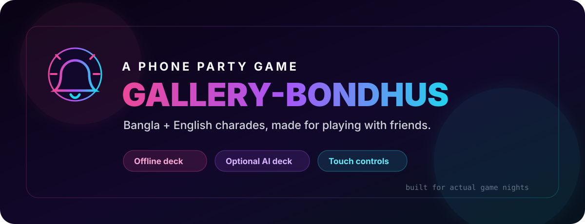
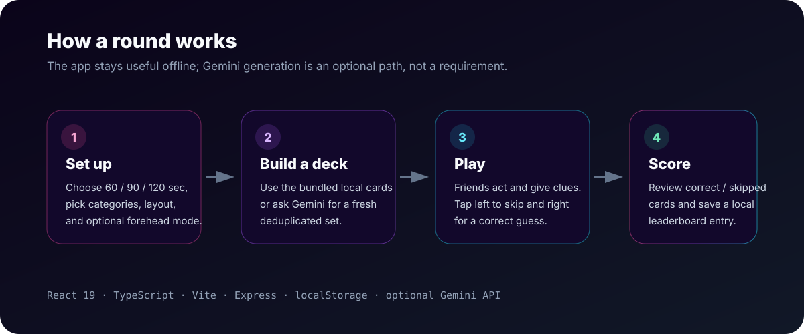

<div align="center">
  
</div>

# Gallery-Bondhus Charades

A small mobile-first charades game made for playing with friends. The card pool mixes Bangla/Bangladeshi references with international pop culture, and the UI is designed around passing a phone around during an actual game night rather than sitting at a desktop.

This is not meant to be a serious competitive platform or a grand AI product. It started as a fun thing for our own group, and it has gradually picked up the practical bits we wanted while using it: quick setup, touch controls, repeat-card filtering, local scores, portrait/landscape handling, an offline deck, and an optional AI-generated deck when we want fresher prompts.

## How a round works

<div align="center">
  
</div>

1. Choose a round duration, categories, and play layout.
2. Use the bundled offline cards, or enable the optional Gemini deck generator.
3. One player holds the phone while the rest of the group acts or gives clues.
4. Tap the left side to skip and the right side for a correct answer.
5. Review the round summary and optionally save the score to the local leaderboard.

## Features

- **Offline-first card deck** — the game is fully playable without an API key.
- **Optional Gemini-generated decks** — fresh cards can be generated from the selected categories and an optional custom instruction.
- **Duplicate/recent-card filtering** — normalized card keys and a local recently-used list reduce repeated prompts between rounds.
- **Bangla + English content** — local references can stay in Bangla while international names remain readable in English.
- **Mobile play layouts** — vertical and manually rotated horizontal layouts are available for phones with orientation lock enabled.
- **Touch gameplay** — large left/right interaction areas keep controls simple while the phone is being held up.
- **Round summaries and local leaderboard** — scores are stored in `localStorage`; there is no account system or remote score database.
- **Graceful AI fallback** — if generation fails or produces too few usable cards, the app falls back to the local deck.

## Tech stack

| Layer | Technology |
| --- | --- |
| UI | React 19 + TypeScript |
| Styling | Tailwind CSS 4 + custom CSS |
| Build tooling | Vite 6 + esbuild |
| Server | Express 4 |
| Optional generation | Google Gemini via `@google/genai` |
| Local persistence | Browser `localStorage` |

## Project structure

```text
.
├── docs/
│   └── images/                 # README artwork and diagrams
├── server/
│   └── index.ts                # Express server + optional Gemini API route
├── src/
│   ├── components/
│   │   ├── GamePlay.tsx
│   │   ├── GameSummary.tsx
│   │   ├── Leaderboard.tsx
│   │   ├── ManualLayoutShell.tsx
│   │   ├── NeonCanvas.tsx
│   │   └── Onboarding.tsx
│   ├── hooks/
│   │   └── useVisualViewportSize.ts
│   ├── utils/
│   │   └── cardQuality.ts      # normalization, dedupe and recent-card logic
│   ├── App.tsx                 # screen flow and game setup state
│   ├── data.ts                 # bundled categories and offline card collection
│   ├── index.css
│   └── main.tsx
├── .env.example
├── index.html
├── package.json
├── tsconfig.json
└── vite.config.ts
```

The frontend and API are kept in the same repository because the app is small and the server only has a narrow job: serve the built client and proxy optional card-generation requests so the Gemini key stays server-side.

## Run locally

### Prerequisites

- Node.js 20+ recommended
- npm

### 1. Install dependencies

```bash
npm install
```

### 2. Configure the optional AI deck

The offline game does **not** require any environment variables. If you want Gemini-generated cards:

```bash
cp .env.example .env
```

Then set:

```env
GEMINI_API_KEY="your_gemini_api_key_here"
```

### 3. Start development mode

```bash
npm run dev
```

The Express server starts the Vite middleware in development and listens on port `3000` unless `PORT` is set.

## Build and run production mode

```bash
npm run build
npm start
```

The client is built into `dist/`, while the bundled Node server is kept separately in `dist-server/`. Keeping those outputs separate prevents backend build artifacts and source maps from being exposed by the static-file server.

Useful checks:

```bash
npm run typecheck
npm run build
# or both:
npm run check
```

## Card generation behavior

When the AI option is enabled, the client requests a larger temporary deck from the server. The server asks Gemini for structured card objects, validates required fields, normalizes card names for duplicate detection, excludes recently seen words, and may make a second generation pass if the usable set is too small.

The client performs another deduplication pass before starting the round. If the AI result is still too short—or the API call fails—the game fills or replaces it with cards from the bundled offline collection. The goal is simply to keep a game playable instead of making network access a hard dependency.

## Local data and privacy

The leaderboard and recently-used-card history live in browser `localStorage`. There are no user accounts and this repository does not include a remote database. If Gemini generation is enabled, the selected categories, optional custom prompt, and recently used card words are sent to the app's server and then used to request a generated deck from Gemini.

## Notes

- The UI is intentionally phone-oriented; desktop use is mostly useful for development and quick testing.
- AI generation is optional and may incur API usage costs depending on the Gemini account/key being used.
- The bundled card list is deliberately opinionated toward the references our group finds recognizable and fun. That is part of the project rather than an attempt at a universal charades dataset.

---

Made as a small game for friends, and kept around because we actually use it.
